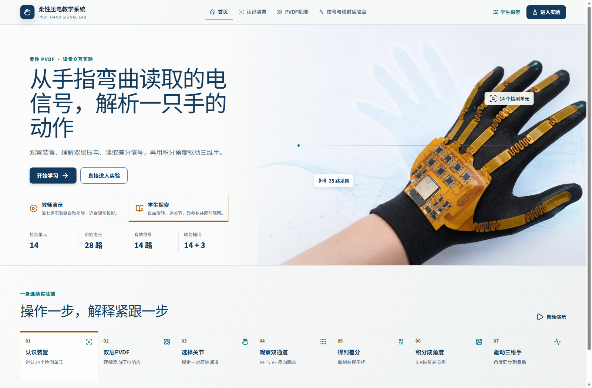
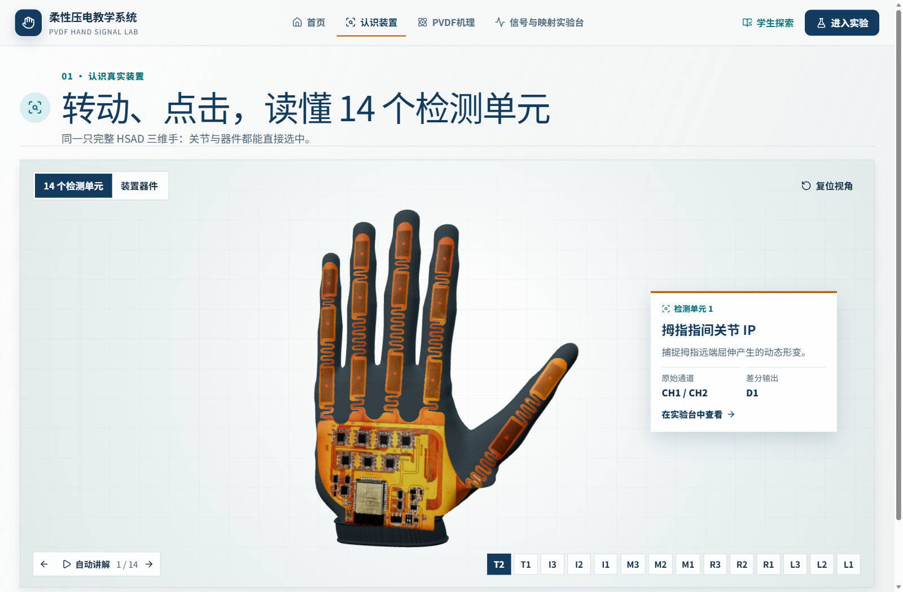
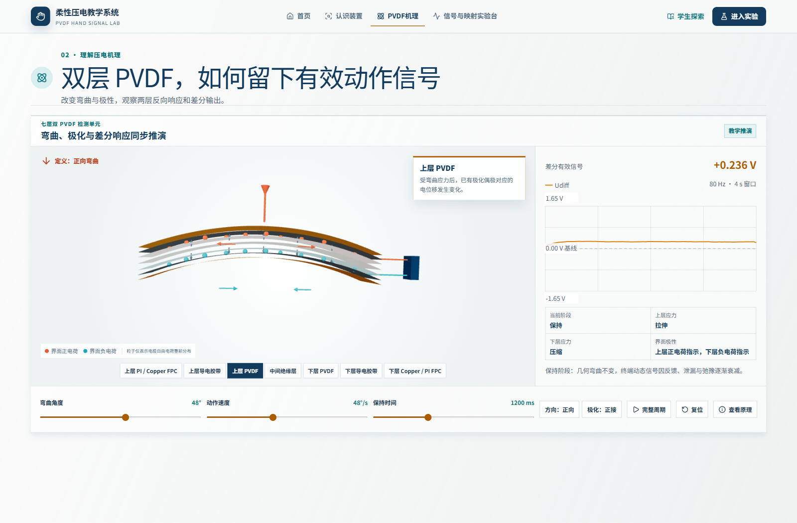
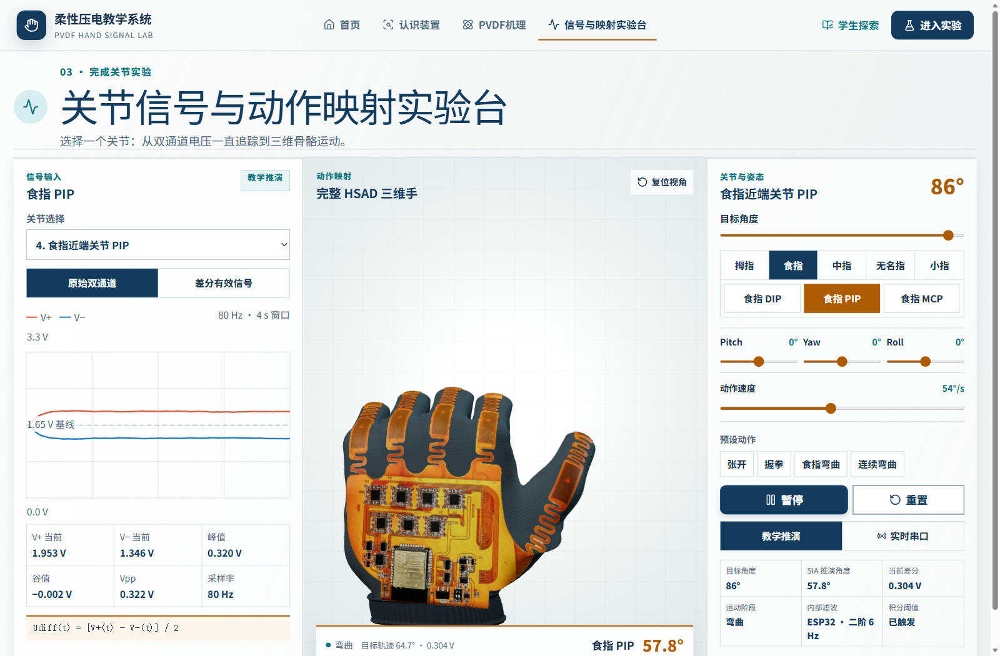

# PVDF Hand Signal Lab

柔性 PVDF 手部动作信号采集与实时映射教学系统。

[打开在线实验室](https://3331083641-prog.github.io/PVDF-Hand-Signal-Lab/)

## 界面截图与操作说明

以下四张截图记录了教学界面，浏览器视口为 1600 × 1050。可点击图片查看原图。

### 1. 首页 · 从佩戴实物开始

佩戴图展示了橙色柔性电路如何从手背延伸到五指。「开始学习」从装置辨认进入课程，「直接进入实验」打开信号与映射实验台。课堂投影可选「教师演示」，个人操作可选「学生探索」。首页的 **28 路原始电压 → 14 路有效信号** 对应后续实验中的通道关系，每个检测单元占用一对原始通道。

### 2. 认识装置 · 把手上的位置对应到采集通道

截图中选中的是 **T2（拇指指间关节）**。说明卡给出原始通道 **CH1 / CH2** 和差分输出 **D1**。点击另一块贴片或下方关节编号，可查看对应通道。切换到「装置器件」可定位手背采集模块、ESP32 和蛇形走线等部件。拖动可从侧面观察走线跨过指关节的位置，点击「复位视角」会回到指尖朝上、手背朝前的视图。

### 3. PVDF 机理 · 对照弯曲阶段与电信号

剖面展示两层 PVDF、中间绝缘层及两侧电极连接。点击「完整周期」，对照「当前阶段」、上下层应力与右侧差分波形。尤其可以观察**保持阶段**：弯曲角度保持不变时，动态输出仍会逐渐衰减。再改变弯曲方向或极化接法，比较相同动作下波形的符号变化。图中数值来自页面的教学推演。

### 4. 信号与映射实验台 · 从一对电压追踪到握拳动作

截图使用「教学推演」输入，选中了**食指近端关节（PIP）**和「握拳」预设。左侧显示该关节的两路原始电压，可切换到「差分有效信号」，比较按 `Udiff = (V+ − V−) / 2` 得到的曲线。中间的三维手显示各指协同握合，右侧可以对照目标角度与 SIA 推演角度，观察运动过程中的跟随变化。试着在「张开」「握拳」「食指弯曲」之间切换，再旋转到掌侧观察拇指位置。连接实体装置时，可切换到「实时串口」观察实测输入。

### 虎口弯曲验证

当前模型基于 `a4001d6`，修正了拇指 MCP 内收时虎口的骨骼绑定。在实验台选择 T1（拇指掌指关节 MCP），将目标角度从 0° 调至 90°，可观察虎口与根部走线随动。

## 目录

- ui/ — Vite、React、TypeScript 源码及本地开发入口。
- ui/assets/blender/ — 可编辑的 Blender 模型。
- ui/assets/reference/ — 正面器件参考照片与布局数据。
- ui/tools/blender/ — 建模、参考图轮廓提取和模型导出脚本。
- ui/docs/ — 教学、串口、模型及工程说明。
- 根目录 index.html、assets/、models/、draco/ — GitHub Pages 网页发布文件。

## 本地开发

~~~powershell
cd ui
npm.cmd ci
npm.cmd run dev -- --host 127.0.0.1
~~~

完整构建与模型重建步骤见 [UI 项目说明](ui/README.md)。

## 本次模型更新

手背器件按参考照片排列，包含四加三芯片阵列、ESP32 金属罩、贴片器件与铜走线。14 个感应区采用照片比例与镂空蛇形连接，并支持关节弯曲和串口动作映射。照片没有尺寸标尺，器件厚度和离手高度按斜视外观估计。
